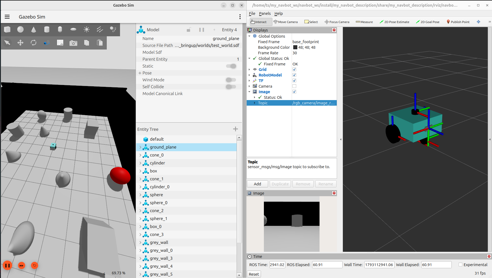
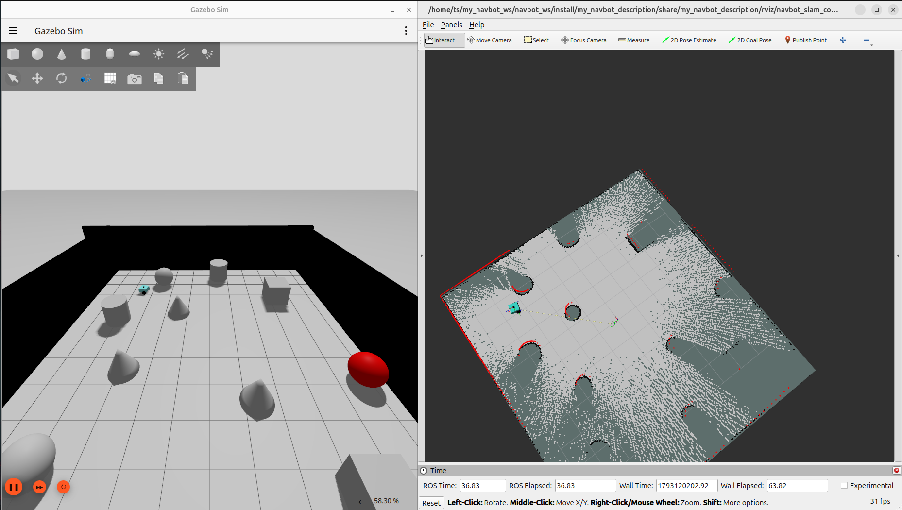
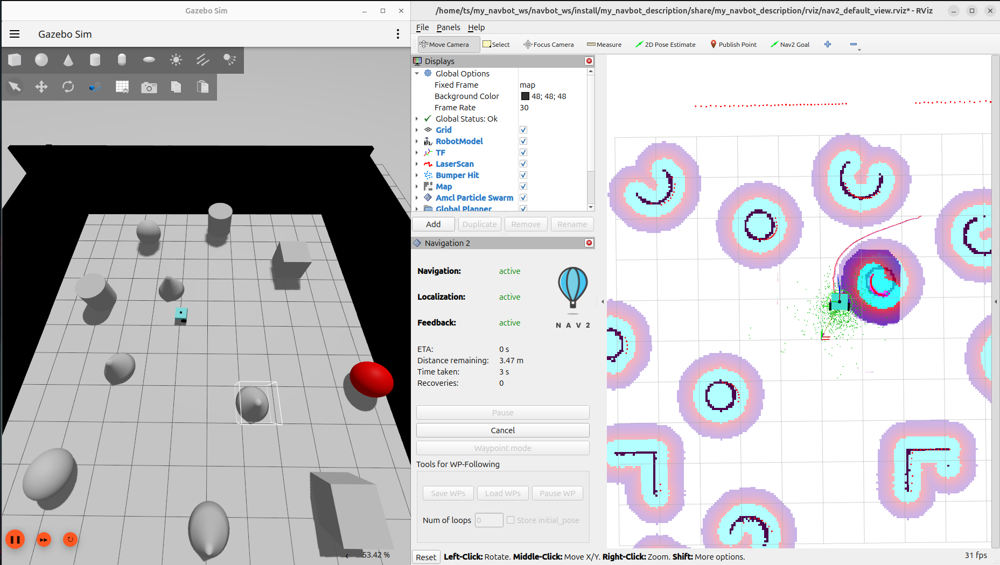
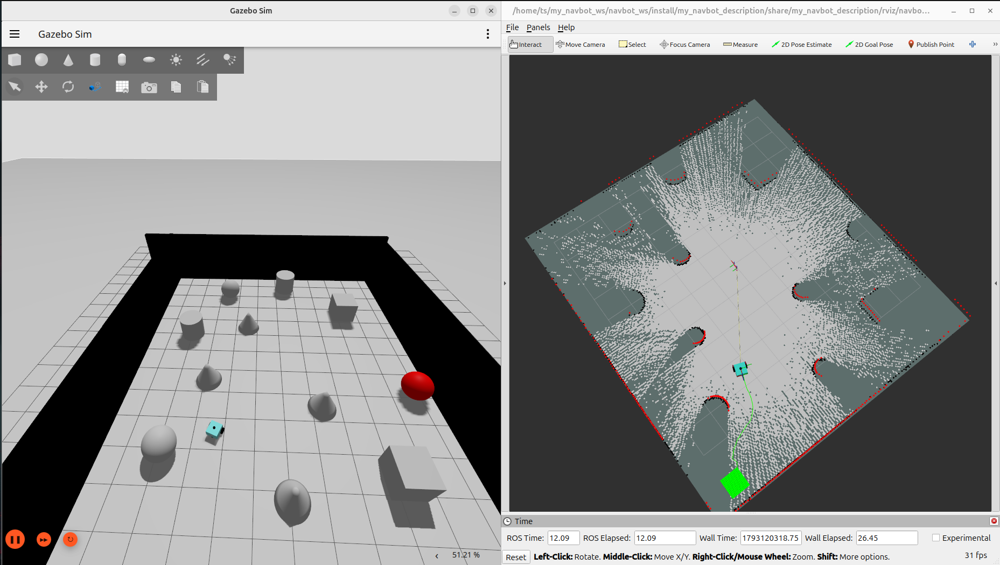

# NavBot — ROS 2 Autonomous Mobile Robot

<p align="center">
  <strong>Simulation • SLAM • Navigation • Exploration</strong><br>
  A modular ROS 2 project for building and experimenting with an autonomous mobile robot in Gazebo and RViz.
</p>

<p align="center">
  
</p>

## Project overview

NavBot is a ROS 2 simulation and navigation workspace. It brings together a Xacro robot model with lidar and depth camera sensors, Gazebo simulation, RViz visualization, Nav2, SLAM Toolbox, and custom nodes for autonomous exploration, waypoint patrol, and map saving.

The repository is organized as four ROS packages:

| Package | What it contains |
| --- | --- |
| `my_navbot_description` | Robot Xacro/URDF, display launch files, and RViz configurations. |
| `my_navbot_bringup` | Gazebo worlds, map assets, Nav2/SLAM configuration, and end-to-end launch files. |
| `my_navbot_interfaces` | Custom `SetPose` service and `CurrentPose` message. |
| `my_navbot_tools` | ROS 2 nodes for navigation goals, exploration, map saving, and waypoint patrol. |

## Features

- **Robot model and visualization:** modular Xacro includes for the mobile base, lidar, and depth camera; view the model in RViz.
- **Gazebo simulation:** launch the NavBot in the included `test_world.sdf` or `empty.sdf`, with ROS–Gazebo topic bridging.
- **SLAM and map saving:** build a map using SLAM Toolbox, then save it through the project's map saver service.
- **Nav2 navigation:** navigate to requested map-frame poses and patrol configured waypoints.
- **Autonomous exploration:** choose candidate unknown map cells, request navigation goals, and save the map once exploration reaches its completion threshold.

## Project gallery

### Mapping with SLAM

<p align="center">
  
</p>

### Nav2 navigation

<p align="center">
  
</p>

### Autonomous exploration

<p align="center">
  
</p>

### Demo video

[▶ Watch the NavBot simulation demo](src/docs/media/navbot-demo.gif)

## Requirements

The project targets **ROS 2** and uses Gazebo Sim (`ros_gz`), Nav2, SLAM Toolbox, RViz, Xacro, and the ROS Python packages declared by the packages. Install the corresponding packages for your ROS 2 distribution before building.

Source your ROS installation in each new terminal. The examples below use `ros2`; substitute your distribution's setup path where needed.

## Build and source

Run these commands from the ROS workspace root (the directory containing `src/`):

```bash
cd ~/my_navbot_ws/navbot_ws
source /opt/ros/$ROS_DISTRO/setup.bash
rosdep install --from-paths src --ignore-src -r -y
colcon build --symlink-install
source install/setup.bash
```

For later terminals:

```bash
cd ~/my_navbot_ws/navbot_ws
source /opt/ros/$ROS_DISTRO/setup.bash
source install/setup.bash
```

> If your checkout lives elsewhere, use its workspace root. `rosdep` can only install dependencies that are available for your ROS distribution.

## Run the features

Commands below assume the workspace has been built and sourced as above. Keep the launch running in its terminal; use a second sourced terminal for service calls and inspection.

### 1. View the robot model

```bash
ros2 launch my_navbot_description display.launch.py
```

This opens the robot description in RViz. An XML launch alternative is also provided:

```bash
ros2 launch my_navbot_description display.launch.xml
```

### 2. Launch Gazebo simulation

```bash
ros2 launch my_navbot_bringup my_navbot_gazebo.launch.py
```

This starts Gazebo with `test_world.sdf`, spawns the robot, starts the configured ROS–Gazebo bridge, and opens RViz. To use the empty world or turn off RViz:

```bash
ros2 launch my_navbot_bringup my_navbot_gazebo.launch.py world:=/path/to/empty.sdf launch_rviz:=false
```

### 3. Create a map with SLAM

```bash
ros2 launch my_navbot_bringup slam.launch.py
```

Drive the robot around the environment using a teleoperation node or RViz interaction while SLAM Toolbox builds the map. Save the current map by calling the map saver service:

```bash
ros2 service call /save_map std_srvs/srv/Trigger "{}"
```

The launch accepts `map_name:=...` and `world:=...` arguments. The map saver currently constructs an absolute output path in `my_map_saver.py`; check that path in your checkout before relying on where files are written.

### 4. Navigate and patrol waypoints

Launch Gazebo, Nav2, RViz, and the waypoint/navigation nodes together:

```bash
ros2 launch my_navbot_bringup nav.launch.py
```

The default map is `test_map.yaml`. Set the robot's initial pose in RViz if localization needs it, then begin or stop patrol from another terminal:

```bash
ros2 service call /start_patrol std_srvs/srv/Trigger "{}"
ros2 service call /stop_patrol std_srvs/srv/Trigger "{}"
```

Patrol coordinates and headings are in `my_navbot_tools/config/waypoints.yaml`. For a one-off goal, the `nav_to_pose_client` node exposes the custom `send_goal` service:

```bash
ros2 service call /send_goal my_navbot_interfaces/srv/SetPose "{x: 1.0, y: 0.5, theta: 0.0}"
ros2 service call /cancel_goal std_srvs/srv/Trigger "{}"
```

`theta` is the desired yaw in radians in the `map` frame.

### 5. Run autonomous exploration

```bash
ros2 launch my_navbot_bringup auto_slam.launch.py
```

This composes SLAM and Nav2 with the exploration and goal-client nodes. Watch the map and frontier markers in RViz as the robot explores. The exploration node is configured to save the map when its completion criterion is reached. Optional launch arguments include `world:=...`, `map_name:=...`, and `params_file:=...`.

## Inspect the ROS graph

Useful commands while a feature is running:

```bash
ros2 node list
ros2 topic list
ros2 service list
```

## Repository map

```text
my_navbot_description/
├── urdf/       # Xacro robot, sensors, and Gazebo configuration
├── launch/     # Model display launch files
└── rviz/       # Visualization profiles
my_navbot_bringup/
├── launch/     # Gazebo, SLAM, Nav2, and autonomous SLAM launches
├── config/     # Nav2, SLAM, and Gazebo bridge parameters
├── maps/       # Example occupancy-grid maps (.yaml + .pgm)
└── worlds/     # Included Gazebo worlds
my_navbot_interfaces/
├── msg/        # CurrentPose.msg
└── srv/        # SetPose.srv
my_navbot_tools/
├── my_navbot_tools/  # ROS 2 Python nodes
└── config/           # Waypoint list
```

## License

The ROS packages declare Apache-2.0. See individual package manifests for package metadata.
